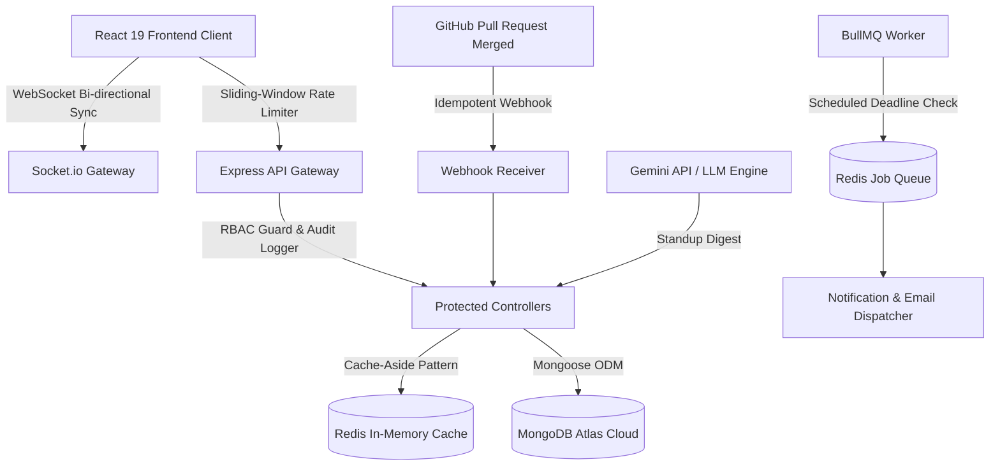

# 🚀 TeamSync — Feature Roadmap, System Audit & Specifications

A comprehensive feature roadmap, architectural specifications, and implementation audit for **TeamSync** — a high-velocity team collaboration and sprint management platform.

---

## 📌 Status Legend
- ⬜ **Planned** (Upcoming feature backlog)
- ⏳ **In Progress** (Active implementation)
- ✅ **Completed** (Fully functional in production)

---

## 🌟 High-Impact Senior Engineering Upgrades (Recruiter & Portfolio Showcase)

Adding these engineering upgrades elevates TeamSync from a standard CRUD application into an enterprise-grade, senior-level distributed system:



### 1. Real-Time Bidirectional Sync (`Socket.io` / WebSockets)
- **Status:** ✅ Completed
- **Goal:** Instant multi-user live updates without page refreshing or background polling.
- **Tech Stack:** `socket.io`, `socket.io-client`.
- **Architectural Scope:**
  - [x] Attached Socket.io server to Node.js HTTP server (`backend/socket/socketManager.js`).
  - [x] Persistent WebSocket connections upon client load and authentication.
  - [x] Broadcast events on database mutations: `task:created`, `task:updated`, `task:deleted`, `team:created`, `team:updated`, `team:deleted`, `notification:new`.
  - [x] **Live Presence Indicators:** Header displays real-time online collaborator avatars and dynamic `Live Sync` connection indicator.
  - [x] Multi-client auto-reconciliation on Tasks and Dashboard views without manual page refreshes.

### 2. Granular Role-Based Access Control (RBAC) & Immutable Audit Logging
- **Status:** ✅ Completed
- **Goal:** Strict authorization at the route level with compliance-ready audit trails.
- **Tech Stack:** Express Custom Middleware (`rbacMiddleware.js`), Mongoose Immutability Hooks, JWT Claims, Socket.io live audit stream.
- **Architectural Scope:**
  - [x] Defined hierarchical roles: `Owner` (40) > `Admin` (30) > `Member` (20) > `Guest` (10).
  - [x] Route-gate critical mutations: Only `Owner`/`Admin` can delete tasks/workspaces, invite members, or modify sprint cycles; `Member` can create/edit tasks; `Guest` has strict read-only access.
  - [x] **Immutable Audit Log Collection:** Append-only Mongoose schema (`AuditLog.js`) with database-level hooks rejecting `updateOne`, `updateMany`, `deleteOne`, `deleteMany` to guarantee evidentiary integrity.
  - [x] Security breach logging: Unauthorized route attempts automatically generate an immutable `SECURITY_UNAUTHORIZED_ACCESS` log entry with status `DENIED`.
  - [x] **Audit Trail UI (`/audit-logs`):** Glassmorphic live-streaming table with WebSocket event updates (`audit:created`), inspect modal, KPI counters, and role-based access restrictions.
  - [x] **Interactive Role Switcher Pill:** Built-in testing popover in the user profile footer allowing seamless demonstration of all 4 roles in real time.

### 3. Idempotent Webhooks & Third-Party Integrations (GitHub & Slack)
- **Status:** ⬜ Planned
- **Goal:** Automate deliverable lifecycle through external developer toolchains.
- **Tech Stack:** Webhook Signature Verification (`crypto.timingSafeEqual`), HMAC SHA-256.
- **Architectural Scope:**
  - **Inbound GitHub Webhook:** Listen to `pull_request.closed` events; if merged and branch/PR mentions task title/ID, automatically transition task status to `Done`.
  - **Idempotency Guarantee:** Cache event IDs in Redis to drop duplicate incoming webhook payloads.
  - **Outbound Webhook Dispatcher:** Allow teams to register Slack/Discord webhook URLs for sprint milestone alerts.

### 4. Redis Caching & Sliding-Window Rate Limiting
- **Status:** ⬜ Planned
- **Goal:** Maximize API throughput, protect backend endpoints from abuse, and cut query latency.
- **Tech Stack:** Redis (`ioredis`), Sliding-Window Counter Algorithm.
- **Architectural Scope:**
  - **Cache-Aside Caching:** Cache high-frequency dashboard KPI aggregates and workspace member directories with TTL and key invalidation on mutation.
  - **Sliding-Window Rate Limiting:** Implement token bucket or sliding-window log limiting sensitive endpoints (e.g. max 10 auth requests/min; max 120 task mutations/min per IP).

### 5. Automated Deadline Engine (BullMQ + Redis Job Queue)
- **Status:** ⬜ Planned
- **Goal:** Reliable, distributed background job processing for deliverable reminders and digests.
- **Tech Stack:** `BullMQ`, Redis, Cron Expressions.
- **Architectural Scope:**
  - Replace naive setInterval polling with a resilient background worker queue.
  - Schedule repeatable jobs that evaluate upcoming milestones 24 hours and 1 hour before deadlines.
  - Automatic retry with exponential backoff on worker failure.

### 6. AI Sprint & Task Summarizer (LLM Standup Generator)
- **Status:** ⬜ Planned
- **Goal:** One-click sprint retrospectives, blocker analysis, and daily standup generation.
- **Tech Stack:** Google Gemini API (`@google/genai`), Prompt Engineering.
- **Architectural Scope:**
  - Endpoint `POST /api/ai/sprint-summary` aggregating overdue tasks, completed deliverables, and team workload distribution.
  - Generate executive summaries: "What was delivered this week", "Current blockers", and "High-risk upcoming deadlines".
  - One-click copy for Slack/Teams standup updates.

### 7. Production DevOps Pipeline & OpenAPI Documentation
- **Status:** ⬜ Planned
- **Goal:** Enterprise delivery standards with automated testing and self-documenting APIs.
- **Tech Stack:** Docker, GitHub Actions, Jest, Supertest, Swagger/OpenAPI.
- **Architectural Scope:**
  - Multi-stage containerization with Alpine-based distroless production images for frontend and backend.
  - GitHub Actions CI workflow running lint checks, unit tests, and integration tests on Pull Requests.
  - Interactive Swagger UI documentation at `/api/docs`.

---

### 💼 Senior Engineer CV Bullet Template
> **Engineered a real-time team collaboration platform using React, Node.js, Express, and MongoDB, implementing WebSockets for live task synchronization, RBAC middleware for workspace security, and Redis caching to cut dashboard query latency.**

---

## 🔍 System Audit: Live vs. Hardcoded Features

### 🟢 100% Live & Cloud-Connected Capabilities
- **MongoDB Atlas Cloud Database:** Real-time persistence across replica sets (`mongodb+srv://...`). All tasks, team members, user accounts, workspaces, and notifications are stored and indexed in the cloud.
- **User Authentication & Google Identity Services:** Official Google OAuth integration with ID-token backend verification (`google-auth-library`), `bcryptjs` password hashing, JWT session cookies/headers, and **unified account linking** for matching Gmail addresses.
- **Dynamic Workspaces & Sprints:** Full-featured workspace management with instant switching, custom sprint cycling, inline project creation, and database persistence (`/api/workspaces`).
- **Team Directory with Roles & Availability Status:** Configurable collaborator roles (`Project Lead`, `Frontend`, `Backend`, `UI/UX`, `DevOps`, `QA`, `Product Manager`) and live status indicators (`Active`, `In a Meeting`, `Away`, `Offline`) with inline quick switching.
- **Task Deliverables Management:** Full CRUD operations (`GET`, `POST`, `PUT`, `DELETE`). Dynamic assignee selection from the database, validation for future deadlines, and real-time search/filtering.
- **Workspace Notification Center:** Full-stack notification engine with background polling, dynamic unread badge counters, automated event triggers on task/team/sprint mutations, and proactive 24-hour deadline alert detection.
- **Interactive Calendar Grid:** Dynamically maps real tasks from MongoDB onto monthly calendar grids with month navigation, today jumps, and deliverable preview modals.
- **Dashboard Analytics:** Dynamic KPI calculation (Active Tasks, Upcoming Syncs, Overdue Deliverables, Collaborator Counts) calculated directly from database records.
- **Design System & Zero-Emoji Icon Library:** Clean SVG vector icons across the entire frontend with zero emojis, custom glassmorphic modal design, and responsive layout.

### 🟡 Current Hardcoded / Simulated Functions (To Be Upgraded)
1. **Forgot Password Flow (`frontend/src/pages/Login.jsx`):**
   - *Current State:* Simulates dispatching a reset email with an in-app confirmation banner (`Password reset link dispatched to user@company.com`).
   - *Upgrade Required:* Integrate an SMTP email service provider (e.g. Nodemailer, Resend, SendGrid) to send real password reset tokens.
2. **Cloud Heartbeat Badge (`frontend/src/components/layout/Header.jsx`):**
   - *Current State:* Displays a static `"Live Cloud"` visual indicator with a pulsing green dot.
   - *Upgrade Required:* Wire to a live `/health` heartbeat poll or WebSocket connection state.
3. **Task Assignee Reference (`backend/models/Task.js`):**
   - *Current State:* Stores assignee as a plain text string (`"Alex Morgan"`).
   - *Upgrade Required:* Reference `TeamMember` or `User` via MongoDB `ObjectId` (`ref: 'TeamMember'`).

---

## 🏗️ Phase 1: Core Task Workflow Enhancements

### Feature 1.1: Extended Task Metadata (Status & Priority)
- **Status:** ⬜ Planned
- **Goal:** Allow tasks to be categorized by execution status and urgency.
- **Backend Tasks:**
  - [ ] Update `backend/models/Task.js` schema:
    - `status`: `['To Do', 'In Progress', 'Under Review', 'Done']` (default: `'To Do'`)
    - `priority`: `['Low', 'Medium', 'High', 'Urgent']` (default: `'Medium'`)
    - `tags`: `[String]`
  - [ ] Update `taskController.js` to handle status/priority filtering and updates.
- **Frontend Tasks:**
  - [ ] Add Status & Priority dropdowns in `Tasks.jsx` create/edit modal.
  - [ ] Display visual badges for Priority (`Urgent` = Red, `High` = Orange, `Medium` = Yellow, `Low` = Gray).
  - [ ] Update Dashboard sorting and counters to use the new fields.

---

### Feature 1.2: Dynamic Team Assignee Linking
- **Status:** ⏳ In Progress (Frontend dynamic, Schema upgrade pending)
- **Goal:** Replace raw text assignee input with dynamic selection and database relation to registered team members.
- **Backend Tasks:**
  - [ ] Update `Task.js` schema to reference `TeamMember` via ObjectId:
    ```js
    assignee: { type: mongoose.Schema.Types.ObjectId, ref: 'TeamMember' }
    ```
  - [ ] Populate `assignee` details in task queries (`Task.find().populate('assignee')`).
- **Frontend Tasks:**
  - [x] Replaced text input in task modal with dynamic Assignee `<select>` populated from `/api/team`.
  - [x] Display assignee name and avatar badge on task cards.

---

### Feature 1.3: Interactive Kanban Board
- **Status:** ⬜ Planned
- **Goal:** Visual drag-and-drop workflow columns (`To Do`, `In Progress`, `Under Review`, `Done`).
- **Frontend Tasks:**
  - [ ] Install drag-and-drop library (e.g. `@hello-pangea/dnd`).
  - [ ] Create `KanbanBoard.jsx` component with columns for each status.
  - [ ] Add view switcher on Tasks page: **List View** ⇄ **Kanban Board**.
  - [ ] Implement optimistic drag-and-drop update with instant API sync (`PUT /api/tasks/:id`).

---

### Feature 1.4: Subtasks & Progress Checklist
- **Status:** ⬜ Planned
- **Goal:** Break down larger deliverables into verifiable checklist items.
- **Backend Tasks:**
  - [ ] Add `subtasks` array to `Task.js`:
    ```js
    subtasks: [{ title: String, completed: { type: Boolean, default: false } }]
    ```
- **Frontend Tasks:**
  - [ ] Add checklist UI inside task edit modal.
  - [ ] Display mini progress bar (`X of Y completed`) on task cards.
  - [ ] Allow checking off subtasks directly from the task card.

---

### Feature 1.5: Search, Filtering & Sorting
- **Status:** ✅ Completed
- **Goal:** Instantly locate and organize tasks.
- **Frontend Tasks:**
  - [x] Search input matching title, description, and assignee in real time.
  - [x] Filter by task type pills (`All`, `Review`, `Meeting`, `Deadline`).
  - [x] Relative deadline countdown badges (`Due today`, `Overdue by Xd`, `Due in X days`).

---

## ⚡ Phase 2: Real-Time Collaboration & Communication

### Feature 2.1: Real-Time Live Sync (Socket.io)
- **Status:** ✅ Completed
- **Goal:** Instant multi-user live updates without page refreshing or background polling.
- **Backend Tasks:**
  - [x] Integrate `socket.io` server attached to Node HTTP server (`backend/socket/socketManager.js`).
  - [x] Emit events on `task:created`, `task:updated`, `task:deleted`, `team:updated`, `notification:new`.
- **Frontend Tasks:**
  - [x] Setup `socket.io-client` connection with `SocketContext.jsx`.
  - [x] Listen to events and update state automatically across `Tasks.jsx`, `Dashboard.jsx`, and `NotificationContext.jsx`.
  - [x] Display real-time active collaborator presence avatars and `Live Sync` indicator in Header.

---

### Feature 2.2: Task Comments & Activity History
- **Status:** ⬜ Planned
- **Goal:** Keep team discussions and audit logs attached to specific deliverables.
- **Backend Tasks:**
  - [ ] Create `Comment` model or embed comments in `Task.js`:
    ```js
    comments: [{ user: String, text: String, createdAt: { type: Date, default: Date.now } }]
    ```
  - [ ] Add endpoint `POST /api/tasks/:id/comments`.
- **Frontend Tasks:**
  - [ ] Task Details drawer/modal with comment feed and input.
  - [ ] Auto-generate activity log (`"Alex moved task to Done"`).

---

### Feature 2.3: Team Chat Room
- **Status:** ⬜ Planned
- **Goal:** Built-in team messaging channel.
- **Backend Tasks:**
  - [ ] Create `Message` model (`sender`, `content`, `room`, `timestamp`).
  - [ ] Socket.io handlers for instant messaging.
- **Frontend Tasks:**
  - [ ] Create `/chat` page with team channels and message history.

---

### Feature 2.4: Workspace Notification Center
- **Status:** ✅ Completed
- **Goal:** Full-featured notification center with unread badges, automated event triggers, deadline alerts, and one-click actions.
- **Backend Tasks:**
  - [x] Create `Notification` model with priority, type, read status, and links.
  - [x] Auto-trigger notifications on task creation, updates, and removals (`taskService.js`).
  - [x] Auto-trigger notifications on team collaborator additions (`teamService.js`).
  - [x] Proactive deadline checker for tasks due within 24 hours.
  - [x] Notification endpoints: `GET /api/notifications`, `PATCH /api/notifications/:id/read`, `PATCH /api/notifications/read-all`, `DELETE /api/notifications/:id`, `DELETE /api/notifications`.
- **Frontend Tasks:**
  - [x] Create `NotificationContext` with live background polling and optimistic updates.
  - [x] Interactive `NotificationMenu` flyout popover in Header with unread counter badge.
  - [x] Filter by `All` and `Unread`.
  - [x] Visual vector icons for deadlines, tasks, team, and system events.
  - [x] Click-to-navigate with auto-mark-as-read, manual mark read, and dismiss actions.
  - [x] "Mark all read" and "Clear all" capabilities.

---

## 🗓️ Phase 3: Visual Schedules & Calendar

### Feature 3.1: Interactive Month Calendar Grid
- **Status:** ✅ Completed
- **Goal:** Full interactive monthly calendar grid with milestone previews.
- **Frontend Tasks:**
  - [x] Monthly grid view dynamically calculated from real tasks.
  - [x] Month navigation with previous/next buttons and "Today" jump.
  - [x] Render task pills on their respective deadline days with type color-coding.
  - [x] Click task pill to view full deliverable details modal.

---

### Feature 3.2: Drag-and-Drop Rescheduling
- **Status:** ⬜ Planned
- **Goal:** Reschedule deadlines directly on the calendar.
- **Frontend Tasks:**
  - [ ] Drag task pill to a different date cell to reschedule deadline with instant API sync.

---

### Feature 3.3: Automated Deadline Engine (BullMQ + Redis)
- **Status:** ⬜ Planned
- **Goal:** Distributed background worker queue dispatching automated digest and warning reminders.
- **Backend Tasks:**
  - [ ] Configure `BullMQ` with Redis connection.
  - [ ] Define queue workers processing scheduled reminder jobs.
  - [ ] Retry with exponential backoff on notification service failure.

---

## 🔐 Phase 4: Authentication, Profiles & Workspaces

### Feature 4.1: User Authentication, Google OAuth & Account Linking
- **Status:** ✅ Completed
- **Goal:** Secure login/registration with Google OAuth and unified account linking for matching Gmail addresses.
- **Backend Tasks:**
  - [x] Create `User` model with password hashing (`bcryptjs`) and Google ID support.
  - [x] Google token verification using official `google-auth-library`.
  - [x] Unified account linking: automatically merges manual email accounts with Google sign-ins.
  - [x] Auth endpoints: `POST /api/auth/google`, `POST /api/auth/register`, `POST /api/auth/login`, `GET /api/auth/me`.
  - [x] JWT token generation and verification middleware (`protect`).
- **Frontend Tasks:**
  - [x] Integrated `@react-oauth/google` Google Identity Services wrapper.
  - [x] Created `AuthContext` managing global user state, token persistence, and session verification.
  - [x] Created `/login` page supporting both one-tap Google Sign-In and manual Email/Password with 3D book-page flip.
  - [x] Built `ProtectedRoute` routing guard protecting workspace screens.
  - [x] Updated Sidebar with user avatar, name, email, and one-click Sign Out.

---

### Feature 4.2: Workspaces & Sprint Management
- **Status:** ✅ Completed
- **Goal:** Separate deliverables by workspace/project and manage dynamic sprint cycles.
- **Backend Tasks:**
  - [x] Create `Workspace` model (`name`, `currentSprint`, `sprints`, `description`, `isDefault`).
  - [x] Auto-seed initial standard workspaces (`Main Workspace`, `Mobile App Launch`, `Core Platform API`).
  - [x] REST endpoints: `GET /api/workspaces`, `POST /api/workspaces`, `PUT /api/workspaces/:id`, `DELETE /api/workspaces/:id`.
  - [x] Automated notifications on workspace creation and active sprint transitions.
- **Frontend Tasks:**
  - [x] Create `WorkspaceContext` managing global workspace state and `localStorage` persistence.
  - [x] Interactive Workspace & Sprint flyout menu in Sidebar with active indicator.
  - [x] Dropdown to switch current sprint or advance sprint cycle.
  - [x] Inline new workspace creation with automatic switch.

---

### Feature 4.3: Granular Role-Based Access Control (RBAC) & Audit Logs
- **Status:** ✅ Completed
- **Goal:** Fine-grained authorization tiers (`Owner`, `Admin`, `Member`, `Guest`) and immutable audit trails.
- **Backend Tasks:**
  - [x] Defined role hierarchy: `Owner` (40), `Admin` (30), `Member` (20), `Guest` (10).
  - [x] Implemented `requireRole` Express middleware logging `SECURITY_UNAUTHORIZED_ACCESS` blocks.
  - [x] Created `AuditLog` schema with database-level immutability hooks preventing update and delete operations.
  - [x] Endpoints `GET /api/audit-logs` and `GET /api/audit-logs/stats` with real-time Socket.io dispatching.
  - [x] Protected task, team, and workspace mutations with granular role authorization.
- **Frontend Tasks:**
  - [x] Conditionally rendered administrative actions: Guest read-only protection, Member task creation/editing, and Admin/Owner delete guards.
  - [x] Added `AuditLogs.jsx` view displaying live audit stream, KPI counters, and inspect modal.
  - [x] Added interactive Role Switcher popover in the user profile footer for instantaneous RBAC evaluation and testing.

---

## 📊 Phase 5: Dashboard Analytics & Insights

### Feature 5.1: Productivity Metrics & Charts
- **Status:** ⬜ Planned
- **Goal:** High-level overview of team velocity and health.
- **Frontend Tasks:**
  - [ ] Completion Rate % donut chart.
  - [ ] Workload balance chart (tasks per team member).
  - [ ] Upcoming vs Overdue velocity timeline.

---

## 🤖 Phase 6: AI-Powered Productivity (Smart Tools)

### Feature 6.1: AI Sprint & Task Standup Summarizer
- **Status:** ⬜ Planned
- **Goal:** Analyze overdue deliverables, workload distribution, and milestones to generate standup digests.
- **Backend Tasks:**
  - [ ] Add endpoint `POST /api/ai/sprint-summary` leveraging Google Gemini API.
- **Frontend Tasks:**
  - [ ] "✨ AI Standup Summary" modal on Dashboard.
  - [ ] One-click copy format for Slack/Teams daily standups.

---

## 🛠️ Phase 7: Infrastructure, Caching & DevOps

### Feature 7.1: Centralized API Client & Environment Config
- **Status:** ✅ Completed
- **Frontend Tasks:**
  - [x] Create `frontend/src/api/client.js` with Axios instance, auth interceptor, and env base URL.
  - [x] Refactor all pages (`Tasks.jsx`, `Dashboard.jsx`, `Team.jsx`, `Calendar.jsx`) to use `apiClient` & `taskApi` / `teamApi` / `notificationApi`.
  - [x] Configure `.env` and `.env.example` templates.

### Feature 7.2: Professional UI/UX Overhaul & Zero-Emoji Icon System
- **Status:** ✅ Completed
- **Frontend Tasks:**
  - [x] Modern SaaS Shell with [Sidebar.jsx](file:///c:/Users/GividuE/Documents/GitHub/teamsync-collab-platform/frontend/src/components/layout/Sidebar.jsx) and sticky [Header.jsx](file:///c:/Users/GividuE/Documents/GitHub/teamsync-collab-platform/frontend/src/components/layout/Header.jsx).
  - [x] Zero-dependency vector SVG icon system in [Icons.jsx](file:///c:/Users/GividuE/Documents/GitHub/teamsync-collab-platform/frontend/src/components/common/Icons.jsx).
  - [x] Reusable, responsive [Modal.jsx](file:///c:/Users/GividuE/Documents/GitHub/teamsync-collab-platform/frontend/src/components/common/Modal.jsx) with fixed header and scrollable body.
  - [x] Native Tailwind datetime picker with quick preset buttons (`Tomorrow 5 PM`, `In 3 Days`, `Next Week`, `End of Month`).

### Feature 7.3: Redis Caching & Sliding-Window Rate Limiting
- **Status:** ⬜ Planned
- **Goal:** Sub-millisecond read latency on dashboard metrics and DDoS/abuse mitigation.
- **Backend Tasks:**
  - [ ] Connect `ioredis` client with graceful degradation if Redis is offline.
  - [ ] Cache dashboard aggregation queries (`GET /api/dashboard/stats`).
  - [ ] Implement sliding-window rate limiting middleware for public and protected routes.

### Feature 7.4: Production DevOps Pipeline & OpenAPI Docs
- **Status:** ⬜ Planned
- **Goal:** Automated CI/CD verification and interactive API specifications.
- **DevOps Tasks:**
  - [ ] Multi-stage production `Dockerfile` (Node Alpine + Nginx).
  - [ ] GitHub Actions workflow running Jest / Supertest API suites on commit.
  - [ ] Swagger / OpenAPI specification UI at `/api/docs`.

---

## 🔗 Phase 8: Webhooks & External Tool Integrations

### Feature 8.1: Idempotent Webhook Engine (GitHub & Slack)
- **Status:** ⬜ Planned
- **Goal:** Connect external developer activities to internal sprint deliverables.
- **Backend Tasks:**
  - [ ] Create endpoint `POST /api/webhooks/github` with HMAC-SHA256 signature verification.
  - [ ] Transition task status to `Done` when associated PR is merged.
  - [ ] Implement idempotent request deduplication via Redis.
  - [ ] Outbound Slack webhook dispatcher for sprint milestone alerts.
